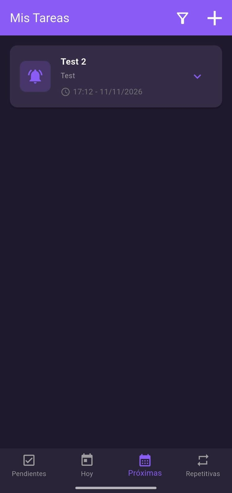
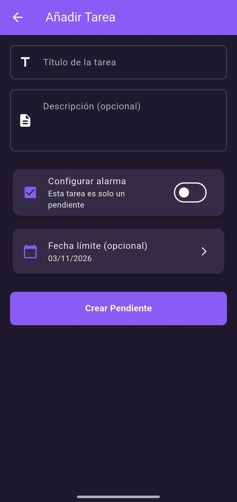
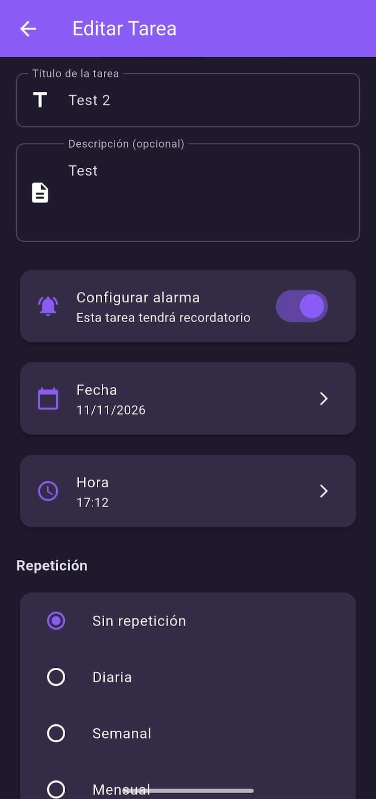
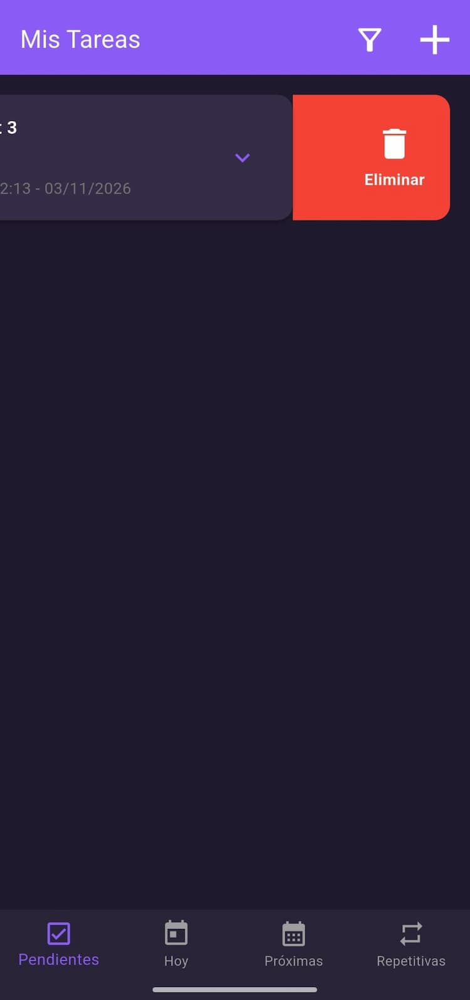
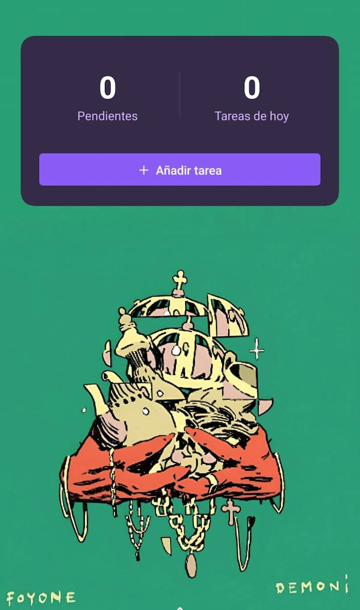

# Todo App

Aplicación Android para organizar tareas y recordatorios, desarrollada con Flutter. Permite mantener pendientes sencillos y programar alarmas para tareas puntuales o recurrentes.

<p align="center" justify="center">
  
  
  
  
  
</p>

## Funciones

- Crear, editar y eliminar tareas, con opción para deshacer una eliminación.
- Añadir descripciones y marcar pendientes como completados.
- Organizar las tareas en las vistas **Pendientes**, **Hoy**, **Próximas** y **Repetitivas**.
- Ordenar por fecha y filtrar por hoy, mañana, semana o mes.
- Configurar recordatorios únicos o recurrentes: diarios, en días de la semana seleccionados y mensuales.
- Recibir notificaciones y alarmas con vibración.
- Consultar desde el widget de Android los pendientes y las tareas de hoy, y abrir el formulario para añadir una tarea.
- Guardar las tareas localmente en el dispositivo.

## Tecnologías

- **Flutter y Dart** para la interfaz y la lógica compartida de la aplicación.
- **Kotlin y Android SDK** para la actividad Android y el proveedor del widget de inicio.
- `shared_preferences` para guardar tareas localmente.
- `flutter_local_notifications`, `timezone`, `workmanager` y `vibration` para notificaciones, programación en segundo plano y alarmas.
- `home_widget` para compartir datos y actualizar el widget de Android.

La aplicación está dirigida a Android. No requiere servidor ni cuenta de usuario; los datos se guardan en el dispositivo.

## Requisitos

- Flutter instalado y disponible en el `PATH`.
- Android SDK y herramientas de compilación configuradas.
- Un dispositivo Android conectado con depuración USB o un emulador.

## Ejecutar y compilar

Desde la carpeta `todo_app`:

```bash
flutter pub get
flutter run
```

Para generar un APK de depuración:

```bash
flutter build apk --debug
```

El APK se genera en `build/app/outputs/flutter-apk/app-debug.apk`.

Para generar un APK de distribución:

```bash
flutter build apk --release
```

La compilación de distribución requiere configurar una clave de firma propia en Gradle; la configuración actual usa firma de depuración.

## Descarga

La versión publicada en GitHub Releases está disponible [aquí](https://github.com/mesegr/ToDo-app/releases/download/V1.0.0/app-release.apk).

## Problemas y sugerencias

Abre un *issue* e incluye una descripción, los pasos para reproducir el problema y, si es posible, una captura o vídeo.
